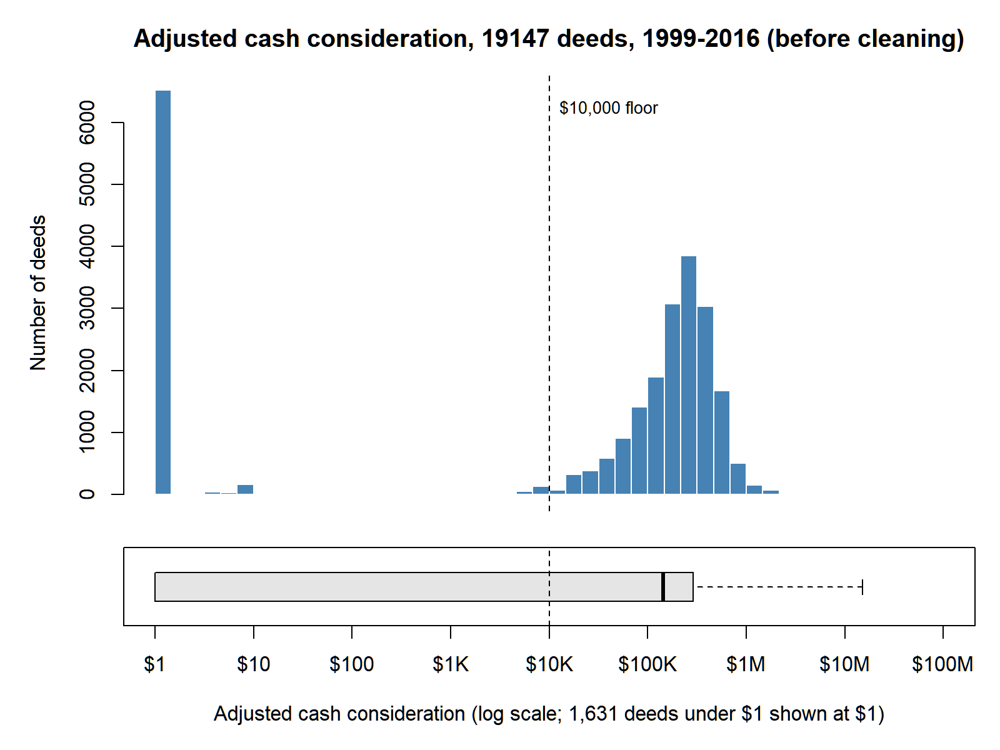
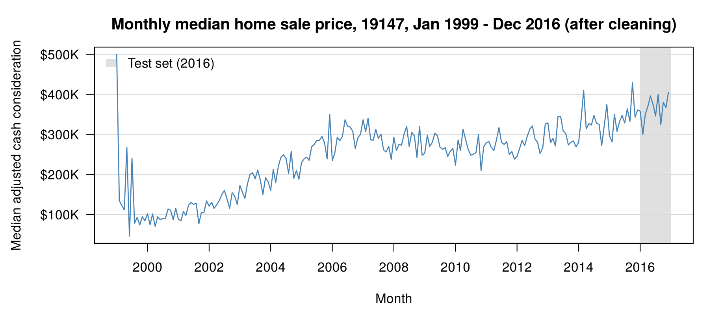

# Data Summary
Our raw data is the City of Philadelphia's Real Estate Transfers dataset [1], downloaded from OpenDataPhilly as a single CSV of every document recorded in the city since December 1999. Each row is one recorded document for one property, such as a deed or a mortgage, described by 47 variables, including the document type, document date, ZIP code, and adjusted cash consideration [2]. The file we downloaded has 5,171,819 rows. From it we built a monthly series of median home sale prices for the 19147 ZIP code (Queen Village, Bella Vista, Pennsport, and nearby neighborhoods [3]) covering January 1999 to December 2016: 216 months, of which the first 204 (1999–2015) train the model and the last 12 (2016) test it. After cleaning, 13,900 deeds remain, with a median price of $250,000. No buyer or seller names appear in any file we publish. The repository stores two derived files: the cleaned deed-level records at `/project2/DATA/rtt_19147_clean.csv`, and the monthly series used for modeling at `/project2/DATA/rtt_19147_monthly.csv`.

# Downloading the Raw Data
To download the data look at data.md for instructions 

# Provenance
Philadelphia's Department of Records records every deed filed in the city and collects the realty transfer tax on property transfers. The city matches each property to its address system, which assigns the ZIP code, gives each property in a multi-property transaction its own row with an equal share of the price, and publishes the records monthly back to December 6, 1999 [1], [2]. Our group downloaded the all-years CSV from OpenDataPhilly in October 2026 and cleaned it with pandas [4] in `/project2/SCRIPTS/code.ipynb`. The script keeps only deeds dated January 1, 1999 through December 31, 2016 whose ZIP code starts with 19147 (so ZIP+4 codes are included). It then removes records with no price, records below a $10,000 price floor chosen from the price histogram (Figure 1), same-day groups of two or more deeds that share one identical price (bulk or multi-property sales), and sales more than three standard deviations from their year's mean log price. The cleaned records are written to `rtt_19147_clean.csv`; the script then takes each month's median adjusted cash consideration and sale count, fills any month with no sales by linear interpolation, and writes the result to `rtt_19147_monthly.csv`. It also writes `cleaning_steps_log.csv`, which records how many rows each step removed. The exploratory figures come from `/project2/SCRIPTS/eda_plots.R`. Figure 1 shows the raw prices before any cleaning; to avoid loading the full CSV into R, the script pulls just the 19147 deeds dated 1999–2016 from the city's Carto SQL API, which serves the same Real Estate Transfers table. Figure 2 is drawn directly from `rtt_19147_monthly.csv`, so it shows exactly the series the model uses.

# License
The data falls under the City of Philadelphia License [5]: the city keeps all rights, provides the data as is with no warranty, and holds users responsible for how they use it. We credit the City of Philadelphia, Department of Records, as the source. Our code is released separately under the MIT License (see `/project2/LICENSE.md`), which does not apply to the data.

# Ethical Statement
The city's records name buyers and sellers. We never analyze those fields and drop them during cleaning. The cleaned file keeps each deed's street address and price, which the city already publishes, but no names, and our analysis uses only ZIP-wide monthly medians. Our forecasts describe a ZIP-wide median, not the value of any one home, and should not be taken as financial advice.

# Data Dictionary
## Raw data: `rtt_summary.csv` (not stored in the repository)
The raw file has 47 variables; only the four below are used in cleaning.

| Feature | Type | Description | Values / Range | Missing | Uncertainty |
|:---|:---|:---|:---|:---|:---|
| document_type | String | Kind of recorded document [2] | 35 categories (e.g., DEED, MORTGAGE) | 0 | Some. Includes several deed variants (e.g., Sheriff Deed, Deed of Condemnation); only plain DEED records are kept. |
| document_date | POSIXct | Date written on the document [2] | 59,635 unique date-times, format YYYY-MM-DD HH:MM:SS UTC | 4,002,278 | A lot. Includes impossible dates from year 1016 to year 9798; dates outside 1999–2016 are removed. |
| zip_code | String | 5-digit ZIP or ZIP+4 code of the property | 45,797 unique codes | 321,921 | ZIP+4 codes are stored separately from their 5-digit code, so we match on codes that start with 19147. |
| adjusted_cash_consideration | Numeric | Cash price paid in USD, divided by the number of properties on the document [2] | $0 to $5,975,000,000 | 3,207,293 | Includes values that cannot be market sales, such as $0 and $1 deeds (mostly tax-exempt transfers, e.g., between family members [6]); handled with the price floor and outlier rules above. |

## `rtt_19147_clean.csv`
One row per deed that survived cleaning: 13,900 deeds in ZIP 19147 dated January 1999 to December 2016, with 7 columns. Yearly counts range from 572 (2011) to 1,073 (2005), except 1999, which has only 141.

| Feature | Type | Description | Values / Range | Missing | Uncertainty |
|:---|:---|:---|:---|:---|:---|
| document_id | Integer | City-assigned ID of the recorded deed; unique row identifier | 13,900 unique | 0 | None. No duplicates. |
| document_date | Date | Date written on the deed (YYYY-MM-DD) | 1999-01-07 to 2016-12-30; 4,244 unique dates | 0 | The document date can differ from the date the deed was recorded. The city's records begin in December 1999, so the 141 deeds dated in 1999 are mostly older documents recorded late, and only 67 fall in January–November. |
| street_address | String | Street address of the property | 8,505 unique addresses | 0 | Not an identifier: the same property appears once per sale. Unit numbers are included for condos (e.g., "UNIT 1103D"). |
| zip_code | String | 5-digit ZIP code | 19147 only | 0 | ZIP+4 codes were trimmed to 5 digits. ZIP codes come from the city's address matching and may be wrong for a few properties. |
| adjusted_cash_consideration | Numeric | Price paid per property in USD | $10,000 to $2,303,000; median $250,000, mean $293,975 | 0 | 75 rows have non-whole-dollar prices (e.g., $358,333.33), most likely shares of multi-property deeds that the city split equally, which may not match each property's real value. Not adjusted for inflation. |
| year | Integer | Year of document_date | 1999 to 2016 | 0 | None. Derived from document_date. |
| month_year | String | Month and year of document_date (YYYY-MM); used to group deeds into the monthly series | 215 of the 216 months from 1999-01 to 2016-12 | 0 | March 1999 has no deeds, so that month's median in the monthly file is interpolated. |

## `rtt_19147_monthly.csv`
The final series used for modeling: one row per month, 216 rows (January 1999 to December 2016), with 4 columns.

| Feature | Type | Description | Values / Range | Missing | Uncertainty |
|:---|:---|:---|:---|:---|:---|
| month_year | String (YYYY-MM) | Month and year of the deeds | 1999-01 to 2016-12 | 0 | None. One row per month, no duplicates. |
| median_price | Numeric | Median adjusted cash consideration of that month's deeds, in USD; months with no deeds are filled by linear interpolation. This is the column the model uses. | $45,750 to $500,000; $70,000 (2000-04) to $429,500 (2015-10) from 2000 on | 0 | High in early 1999. January–October 1999 medians rest on 1 to 10 deeds each, so they are very noisy (both extremes fall in 1999). From 2000 on, every month has at least 22 deeds (fewest in 2009-01). March 1999 is an interpolated estimate, not an observed median. Not adjusted for inflation. |
| sale_count | Integer | Number of deeds used to compute the month's median | 0 to 127 (2007-06); median 65 | 0 | Counts sales left after cleaning, not every sale in the ZIP code. 0 only for March 1999. |
| interpolated | Boolean | True if the month had no deeds and its median_price was interpolated | True for 1 month (1999-03), False otherwise | 0 | None. |

## `cleaning_steps_log.csv`
One row per cleaning step in `code.ipynb`, 9 rows, with 4 columns: `step` (what the step did), `records_before`, `records_removed`, and `records_remaining`. It starts at 5,171,819 raw records and ends at the 13,900 deeds in `rtt_19147_clean.csv`.

# Exploratory Plots

***Figure 1.** Histogram and box plot of adjusted cash consideration before cleaning for 19147 deeds, 1999–2016, on a log scale. The dashed line marks the $10,000 price floor; the cluster of values far below it is $0 and $1 transfers that are not market sales.*

***Figure 2.** Median adjusted cash consideration by month after cleaning, January 1999 to December 2016. Prices climb to 2005, stay flat to about 2012, then rise again, and summer months tend to sit above winter months, matching the seasonal pattern found in U.S. and U.K. housing markets [7]. The shaded year (2016) is the test set.*

# References
[1] City of Philadelphia, Department of Records, "Real estate transfers," OpenDataPhilly. [Online]. Available: https://opendataphilly.org/datasets/real-estate-transfers/ [Accessed Oct. 13, 2026].

[2] City of Philadelphia, "Real Estate Transfer Tax Documents (RTT Summary)," Metadata Catalog. [Online]. Available: https://metadata.phila.gov/#home/datasetdetails/5a04b8d39202605970a7457d/representationdetails/5a04b8d39202605970a74581/ [Accessed Oct. 13, 2026].

[3] Statistical Atlas, "ZIP Code 19147, Pennsylvania (ZIP Code)." [Online]. Available: https://statisticalatlas.com/zip/19147/Overview [Accessed Oct. 13, 2026].

[4] pandas development team, "pandas - Python Data Analysis Library," pandas, 2026. [Online]. Available: https://pandas.pydata.org/ [Accessed Oct. 15, 2026].

[5] City of Philadelphia, "What are the terms of use?," Metadata Catalog Help. [Online]. Available: https://metadata.phila.gov/#help/help-faqs/what-are-the-terms-of-use/ [Accessed Oct. 13, 2026].

[6] City of Philadelphia, "Realty transfer tax," phila.gov. [Online]. Available: https://www.phila.gov/services/payments-assistance-taxes/property-taxes/realty-transfer-tax [Accessed Oct. 14, 2026].

[7] L. R. Ngai and S. Tenreyro, "Hot and cold seasons in the housing market," *Amer. Econ. Rev.*, vol. 104, no. 12, pp. 3991–4026, Dec. 2014, doi: 10.1257/aer.104.12.3991. [Accessed Oct. 14, 2026].
