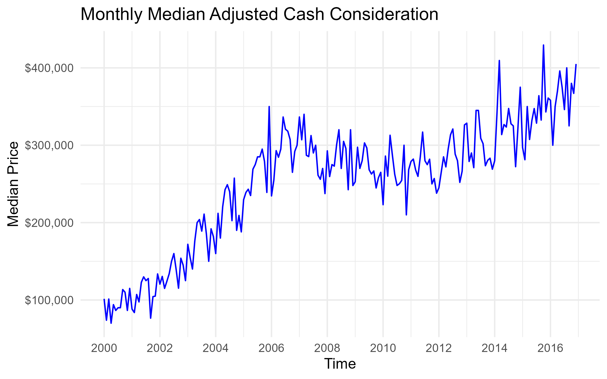
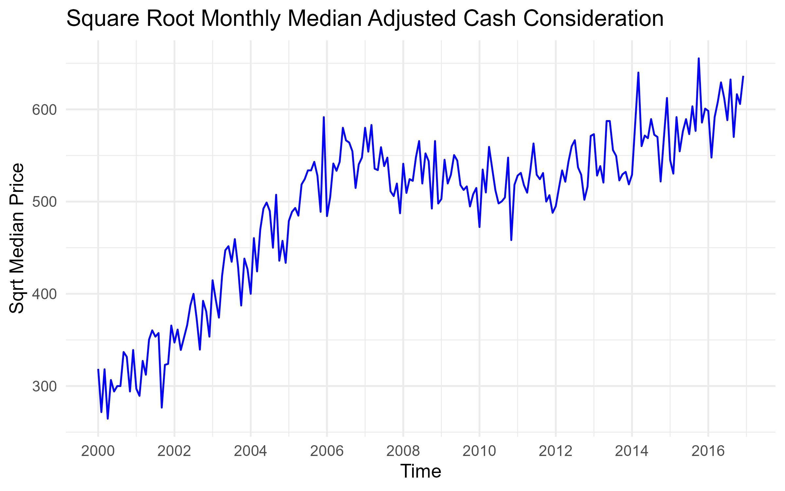
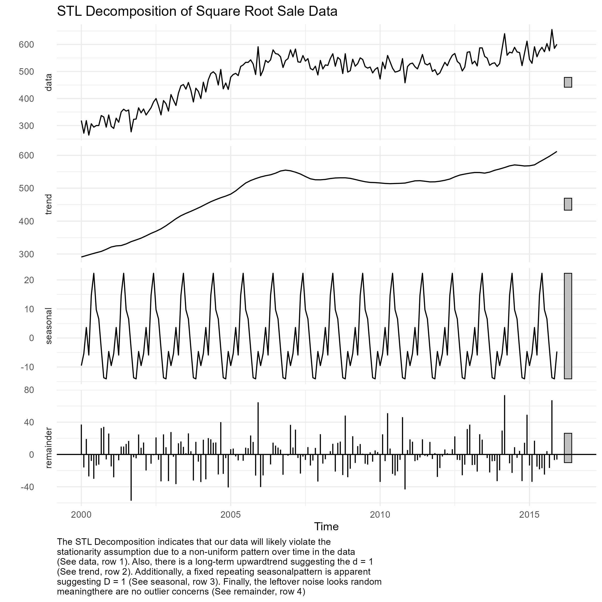
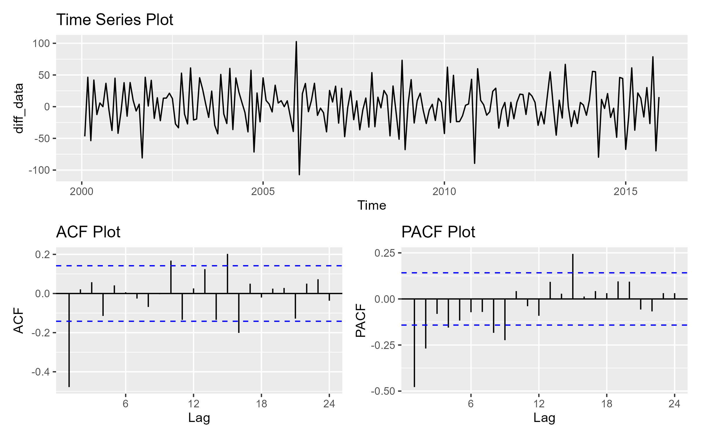
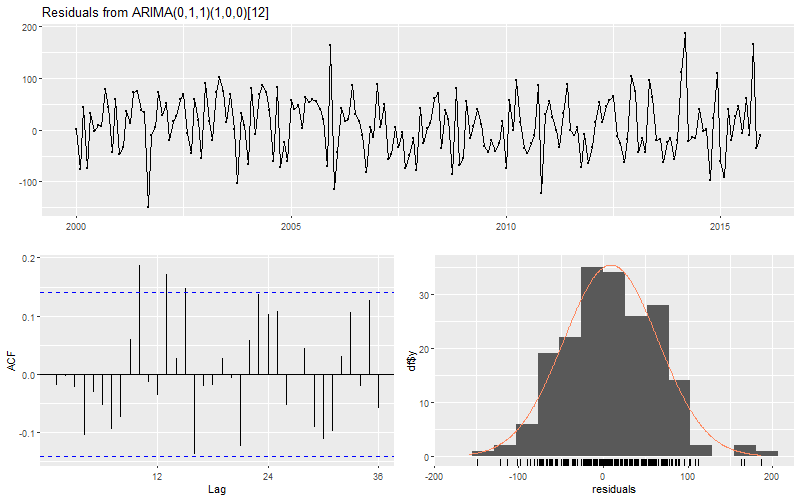
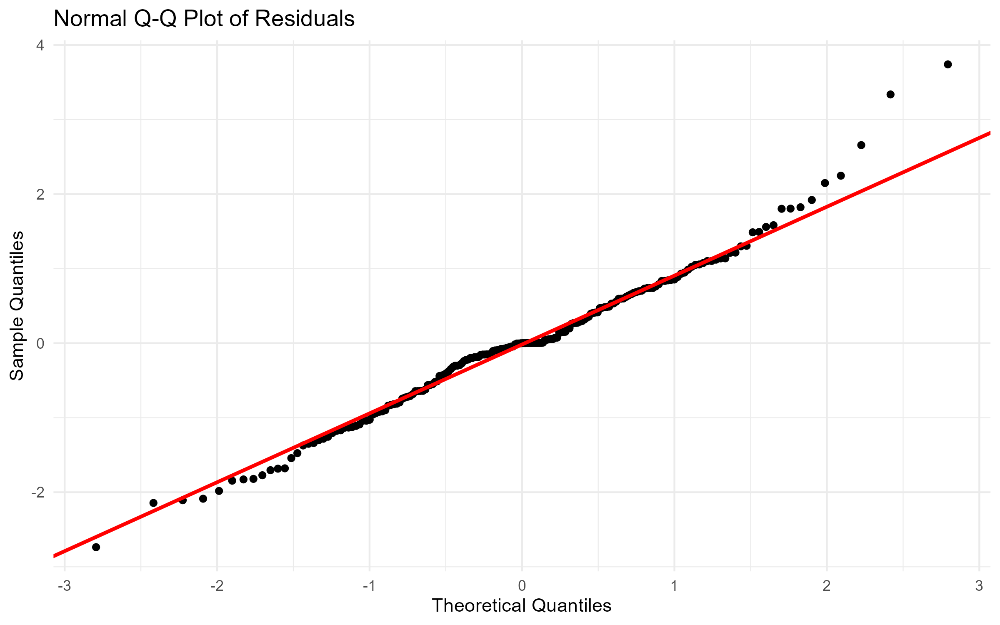
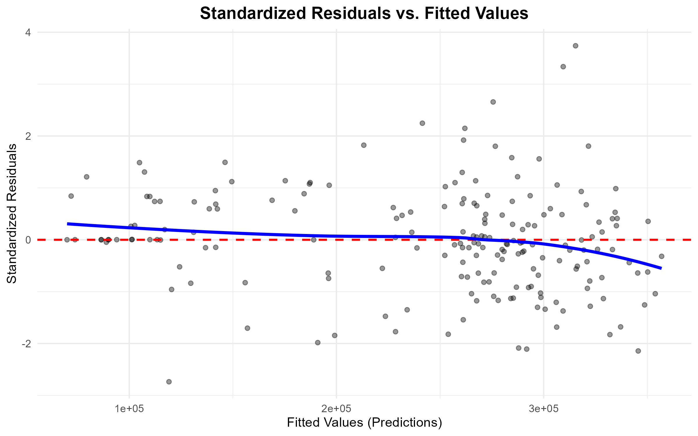
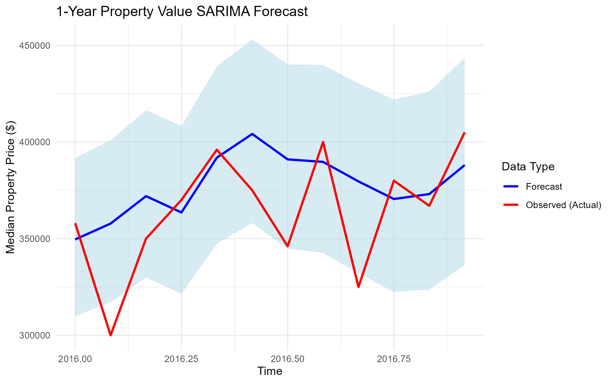
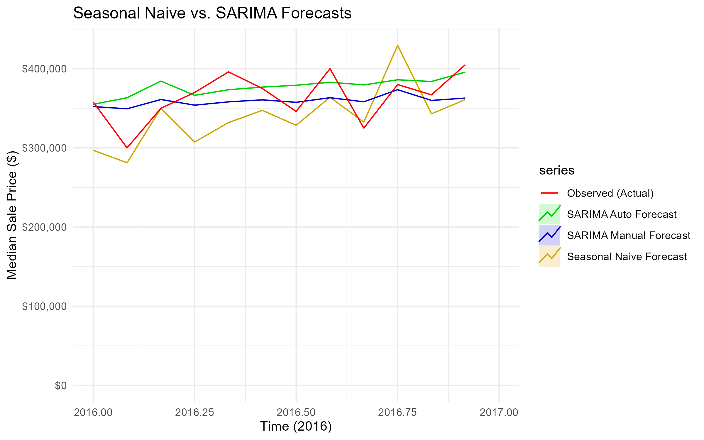

# Output Visualization Explanations
# Initial Time-Series Visualizations

This graph shows the original time series of property prices from 2000 to 2016. Implies a transformation is needed due to the inconsistent peaks and valleys over time.

This graph shows the time series of property prices from 2000 to 2016 after a square root transformation. After a Box-Cox test that indicated a lambda of 0.416, based on general interpretation conventions, this supports using a square root transformation to help with heteroscedasticity.

# Parameter-related Visualizations
## STL Decomposition

An STL decomposition breaks down a time series into its three components: a trend, a seasonal pattern, and residual noise. This decomposition was done on the square root-transformed data, which indicates that our data will likely violate the stationarity assumption due to a non-uniform pattern over time in the data (See data, row 1). Also, there is a long-term upward trend suggesting d = 1 (See trend, row 2). Additionally, a fixed repeating seasonal pattern is apparent, suggesting D = 1 (See seasonal, row 3). Finally, the leftover noise looks random, meaning there are no outlier concerns (See remainder, row 4).

## ACF and PACF Plots

**ACF Plot (left):** The ACF is a chart that shows how strongly a time series is correlated with past versions of itself across different time steps, called lags. ACF guides our parameter selection for the q, Q, and P parameters. Specifically, the last lag outside the significance band initially is lag 1, which suggests q = 1. Since the lag is positive at S (12) this suggests P = 1 and Q = 0, however, since the lag is small, it could be flipped, but we are confident P and Q are between 0 and 1.

**PACF Plot (right):** The PACF is a chart that shows the direct correlation between an observation and its lagged values (after removing the influence of all shorter lags). PACF guides our parameter selection for p, but also guides the interpretation of q, Q, and P. Specifically, the last lag outside the significance band is lag 2, which suggests p = 2; however, since we observe a tailing off in significance after lag q (1), that suggests p could be 0. Thus, we are confident p is between 0 and 2, but for the manual model we select 0 since that indicates a simpler model, which is preferable.

# Model Diagnostic Plots

## Residual Time Plot (top), ACF of Residuals (left), Histogram of Residuals (right)

**Residuals vs. Time (Top):** This plot helps check homoscedasticity. It shows a general rectangular shape and general consistency in spikes, suggesting no homoscedasticity violation.

**ACF of Residuals (Left):** This plot helps check for autocorrelation; ideally, there should be no spikes, as these can indicate leftover autocorrelation. We do notice two significant spikes, but after checking with a Ljung-Box test with a p-value of 0.157, we can confidently reject the null (the residuals are not autocorrelated), which confirms the residuals are behaving like white noise (not autocorrelated).

**Histogram of Residuals (Right)** This plot helps check for normality. The residuals largely follow a normal distribution, but we will complete a more robust check using a Q-Q plot.

## Q-Q Plot

Since the residuals hug the line, we can conclude that our residuals are normally distributed.

## Standardized Residuals vs. Fitted Values

Since the residuals follow a rectangular shape, instead of fanning out, we can further conclude that there is no violation of homoscedasticity. Additionally, since the fitted line does not have a U-shape, we can assume linearity in the data. 

# Forecast Plots

## Manual Model Forecast vs. Observed

This plot shows how the SARIMA(0,1,1)(1,0,0)[12] forecast 12 months ahead (year 2016) compares to the actual observed property sale prices in 2016.  

## All Model Comparisons

This plot shows how the manually selected SARIMA(0,1,1)(1,0,0)[12] model's 12-month horizon forecast compares with the automatically selected SARIMA(0,1,1)(2,0,0)[12] model and the seasonal naive model, which forecasts to be equal to the actual observed value from the last corresponding season (from 2015). These are all compared to the observed values for that 12-month horizon (2016). Overall, the automatic model tends to overestimate actual prices, and the seasonal naive is unstable, frequently underestimating. 
