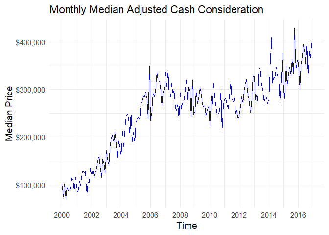
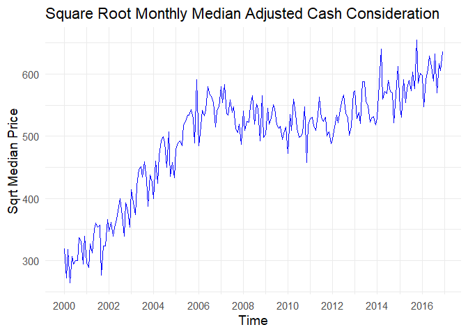
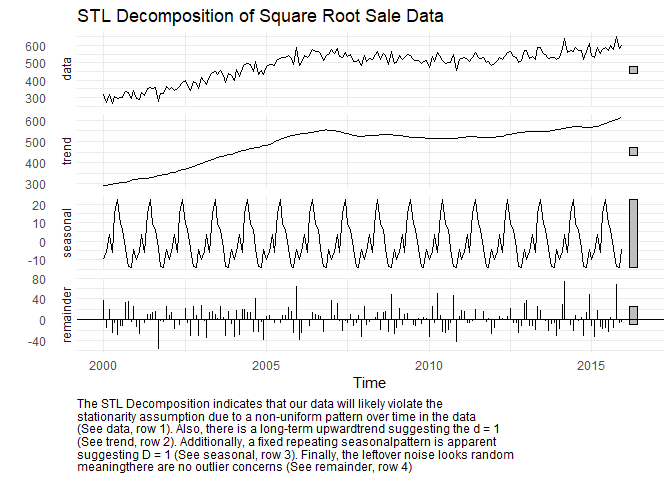
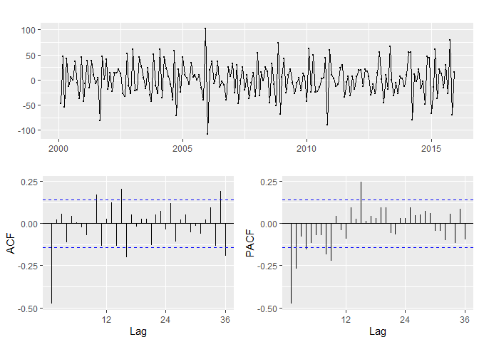
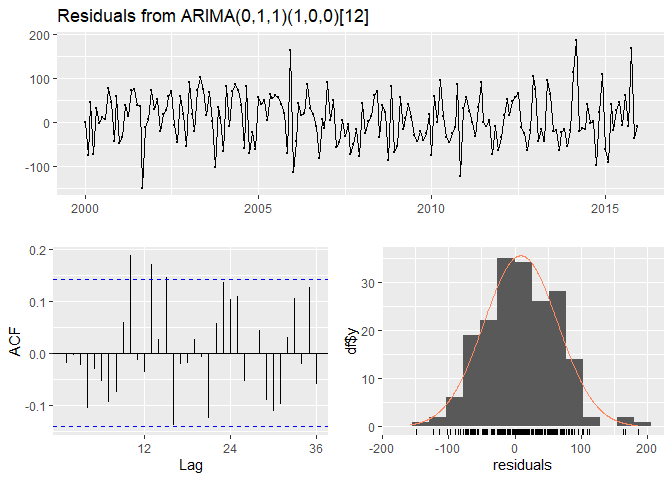
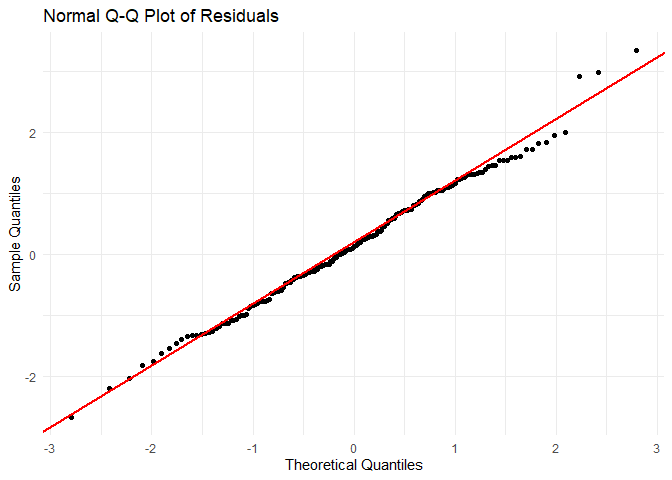
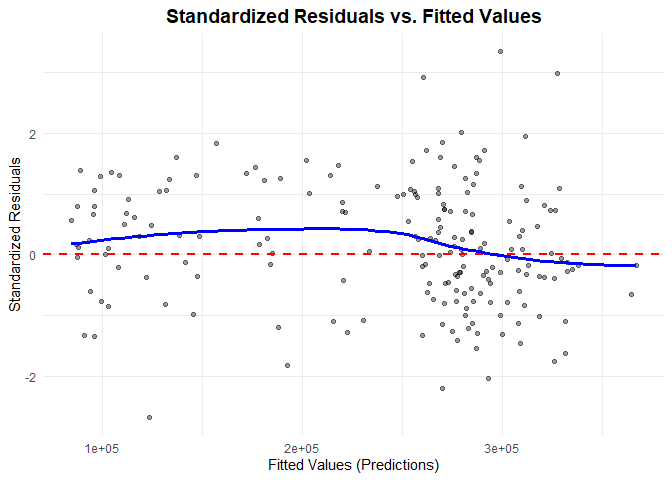
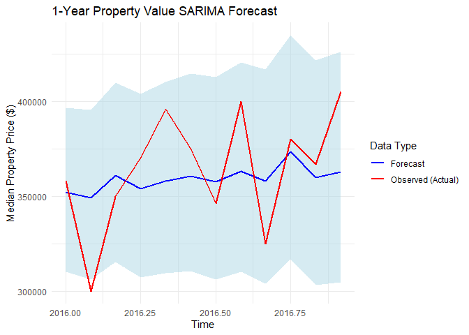
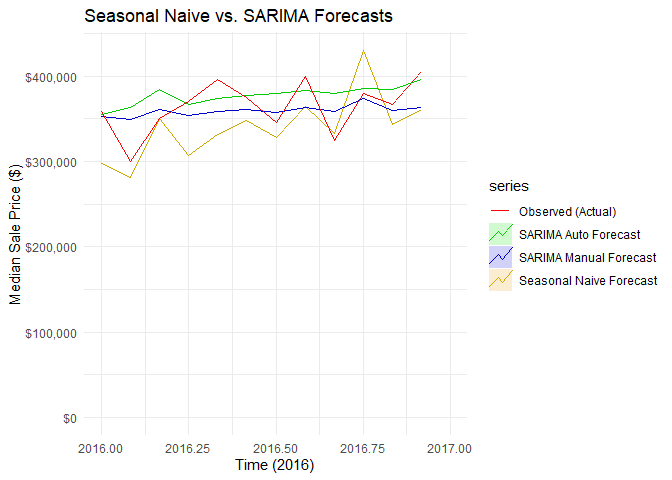

SARIMA Analysis
================
Caroline Clippinger
2026-10-26

# General Information

This data cleaning script is purposed with completing the SARIMA
analysis for the 2000-2016 Philadelphia 19147 property sales. Includes
assumptions checks, data transformation, a train/test split, STL
decomposition, ACF and PACF plots, a model parameter optimization grid,
and comparisons in model performance across the selected manual model,
automatic model, and seasonal naive model. Ultimately, we determined the
best model to be the one selected from the optimization grid:
SARIMA(0,1,1)(1,0,0)\[12\]. The necessary data file can be found at
DS-4002-group-01/project2/DATA/rtt_19147_monthly.csv in the GitHub It
also requires the following packages: `dplyr`, `forecast`, `ggplot2`,
`tseries`, `here`, `scales`, and `patchwork`. To install these packages
use the `install.packages(c("package_name1", "package_name2", ...))`
syntax.

# Loading Packages and Data

``` r
# Documenting current R version
message("Current R Version: ", R.Version()$version.string)
```

    ## Current R Version: R version 4.5.3 (2026-03-11 ucrt)

``` r
# Installing and loading necessary packages
# Uncomment the following if you do not already have these packages downloaded
#install.packages("dplyr")
#install.packages("forecast")
#install.packages("ggplot2")
#install.packages("tseries")
#install.packages("here")
#install.packages("scales")
#install.packages("patchwork")

library(dplyr)
```

    ## 
    ## Attaching package: 'dplyr'

    ## The following objects are masked from 'package:stats':
    ## 
    ##     filter, lag

    ## The following objects are masked from 'package:base':
    ## 
    ##     intersect, setdiff, setequal, union

``` r
library(forecast) # helps build SARIMA models
library(ggplot2) # for plotting
library(tseries) # for stationarity tests
```

    ## Registered S3 method overwritten by 'quantmod':
    ##   method            from
    ##   as.zoo.data.frame zoo

``` r
library(here) # for loading data
```

    ## here() starts at C:/Users/Caroline Clippinger/OneDrive/Documents/College Documents/UVA/UVA Fall 2026/DS4002 DS Project/DS-4002-group-01

``` r
library(scales) 
library(patchwork) # for arranging graphics to save

# Documenting package versions
message("\nLoaded package versions:\ndplyr = ", packageVersion("dplyr"), "\nforecasts = ", packageVersion("forecast"), "\nggplot2 = ", packageVersion("ggplot2"), "\ntseries = ", packageVersion("tseries"), "\nhere = ", packageVersion("here"), "\nscales = ", packageVersion("scales"), "\npatchwork = ", packageVersion("patchwork"))
```

    ## 
    ## Loaded package versions:
    ## dplyr = 1.2.1
    ## forecasts = 9.0.2
    ## ggplot2 = 4.0.3
    ## tseries = 0.10.63
    ## here = 1.0.2
    ## scales = 1.4.0
    ## patchwork = 1.3.2

``` r
# Loading the data
data <- read.csv(here("project2/DATA/", "rtt_19147_monthly.csv"))
```

# Preparation for Analysis

## Data Preparation

``` r
# Converting date variable into time series format
# This requires that during data cleaning the price variable is already ordered by month-year combination or else the time-series values will be misattributed to incorrect time points

head(data, 12) # already in order, minimal observations for 1999 so switching to 2000-2016
```

    ##    month_year median_price sale_count interpolated
    ## 1     1999-01       500000          1        False
    ## 2     1999-02       134250          2        False
    ## 3     1999-03       122725          0         True
    ## 4     1999-04       111200          2        False
    ## 5     1999-05       267500          2        False
    ## 6     1999-06        45750          4        False
    ## 7     1999-07       240000          3        False
    ## 8     1999-08        78000          5        False
    ## 9     1999-09        92500          5        False
    ## 10    1999-10        73500         10        False
    ## 11    1999-11        94000         33        False
    ## 12    1999-12        84000         74        False

``` r
data_clean <- data[-c(1:12), ]
head(data_clean, 12)
```

    ##    month_year median_price sale_count interpolated
    ## 13    2000-01       101500         52        False
    ## 14    2000-02        73850         56        False
    ## 15    2000-03       101250         80        False
    ## 16    2000-04        70000         65        False
    ## 17    2000-05        94000         75        False
    ## 18    2000-06        86500         78        False
    ## 19    2000-07        90000         78        False
    ## 20    2000-08        90000         64        False
    ## 21    2000-09       113500         72        False
    ## 22    2000-10       110000         60        False
    ## 23    2000-11        86500         70        False
    ## 24    2000-12       115000         51        False

``` r
ts_data <- ts(data_clean$median_price, start = c(2000, 1), frequency = 12) # from stats - defining the first observation in the time-series values to be January (1) of 2000 and a seasonal frequency of 12, indicating monthly data
# S = frequency (will confirm later with ACF, will be shown as biggest spike)
```

## Initial Data Visualization and Transformation

``` r
autoplot(ts_data, color = "blue") + # from ggplot2
  labs(
    title = "Monthly Median Adjusted Cash Consideration",
    x = "Time",
    y = "Median Price"
  ) +
  scale_y_continuous(labels = label_dollar()) +
  scale_x_continuous(breaks = seq(2000, 2016, by = 2)) +
  theme_minimal(base_size = 14) + # sets base font size
  theme(legend.position = "none")
```

    ## Scale for x is already present.
    ## Adding another scale for x, which will replace the existing scale.

<!-- -->

``` r
ggsave(here("project2/OUTPUT/", "monthly_median_price_time_series.png"), width = 8, height = 5)

# Very high spike with first date at $500,000, there is only one recorded sale will try to log transform

# If the seasonal spikes have constant peaks and valleys over time, then you do not need a log-transformation, otherwise you need to use log to increase variance stability by compressing larger values more heavily than small ones. Doing this will stabilize the variance, creating constant variance in errors (homoscedasticity) which is needed for reliable metrics. THus, using log we can turn multiplicative noise into additive (constant-sized).

# Test:
BoxCox.lambda(ts_data)
```

    ## [1] 0.4163725

``` r
# If close to 0 (-.2-.2) you need to log transform, closer to one means variance is more stable
# Gets .416 which you round to .5 meaning a square root transformation

# Will do this when running the model later using lambda argument
# lambda = 0

ts_sqrt <- sqrt(ts_data)
autoplot(ts_sqrt, color = "blue") + # from ggplot2
  labs(
    title = "Square Root Monthly Median Adjusted Cash Consideration",
    x = "Time",
    y = "Sqrt Median Price"
  ) +
  scale_x_continuous(breaks = seq(2000,2016, by = 2)) +
  theme_minimal(base_size = 14) + # sets base font size
  theme(legend.position = "none")
```

    ## Scale for x is already present.
    ## Adding another scale for x, which will replace the existing scale.

<!-- -->

``` r
ggsave(here("project2/OUTPUT/", "monthly_median_price_sqrt_time_series.png"), width = 8, height = 5)


outliers <- tsoutliers(ts_sqrt)
print("Outliers present:")
```

    ## [1] "Outliers present:"

``` r
print(outliers)
```

    ## $index
    ## integer(0)
    ## 
    ## $replacements
    ## numeric(0)

``` r
# no outliers
```

## Train/Test Split

``` r
# Create Train/Test Split
# For determining parameters you want to use transformed data, but do not want to use in the models
train <- window(ts_sqrt, end = c(2015, 12)) # takes everything up until December of 2015
test <- window(ts_sqrt, start = c(2016, 1)) # takes everything starting at January of 2016

# This will be used for the models
train_raw <- window(ts_data, end = c(2015, 12)) # takes everything up until December of 2015
test_raw <- window(ts_data, start = c(2016, 1)) # takes everything starting at January of 2016
```

# Checking Stationarity

## Visualizations

``` r
# STL Decomposition (Seasonal, Trend, Residual components)
decomposition <- stl(train, s.window = "periodic")

autoplot(decomposition) +
  labs(title = "STL Decomposition of Square Root Sale Data",
       caption = stringr::str_wrap("The STL Decomposition indicates that our data will likely violate the stationarity assumption due to a non-uniform pattern over time in the data (See data, row 1). Also, there is a long-term upwardtrend suggesting the d = 1 (See trend, row 2). Additionally, a fixed repeating seasonalpattern is apparent suggesting D = 1 (See seasonal, row 3). Finally, the leftover noise looks random meaningthere are no outlier concerns (See remainder, row 4)")) +
  theme_minimal() +
  theme(plot.caption = element_text(hjust=0, vjust=1))
```

<!-- -->

``` r
ggsave(here("project2/OUTPUT/", "stl_decomposition.png"), width = 8, height = 8)

# Interpretation Notes:
# Data (Top panel) = unadjusted time series data (overall sense of data)
# Trend (Second panel) = long-term upward or downward direction of data (visual indication of d) - upward means long-term growth, flattening or reverse means behavior baseline change (indicates d = 1)
# Seasonal (Third panel) = repeating patterns that occur within a fixed, known period (visual indication of D) - should be uniform for stable seasonal pattern (indicates D = 1)
# Remainder (Bottom panel) = leftover noise/variation after removing trend and seasonal effects, outliers will be apparent here - should look random - looks random
```

## Statistical Tests

``` r
# Perform Augmented Dickey-Fuller (ADF) test
adf.test(train) # from tseries
```

    ## 
    ##  Augmented Dickey-Fuller Test
    ## 
    ## data:  train
    ## Dickey-Fuller = -2.1844, Lag order = 5, p-value = 0.499
    ## alternative hypothesis: stationary

``` r
# Null hypothesis: Time-series is non-stationary
# Thus you want to reject the null (p < .05)

# Failed to reject null meaning it is not stationary
```

## Conducting Differencing to Fix

``` r
# This determines value of d (if trend) and S (if seasonality)
# Number of ordinary differences need
d <- ndiffs(train)
cat("\nSuggested number of ordinary differences (d) =", d)
```

    ## 
    ## Suggested number of ordinary differences (d) = 1

``` r
# Number of seasonal differences needed
D <- nsdiffs(train)
cat("\nSuggested number of seasonal differences (D) =", D) # giving 0, but it could be 1 as seen in STL pattern so when optimizing let this be 0-1
```

    ## 
    ## Suggested number of seasonal differences (D) = 0

``` r
# NOTES:
# How you apply differencing (if d = 1 and D = 1) - differences argument default is 1
# Inner diff: Ordinary difference - lag = 1 (always), differences = d
# Outer diff: Seasonal difference - lag = S, differences = D

# Will apply ordinary differencing first, and if ADF test indicates staionarity we will not do seasonal differencing (which nsdiffs indicates should not be necessary), otherwise complete seasonal differencing as well and re-test

# Doign the simplest differencing first to see if it fixes stationarity (AKA ordinary differencing, d = 1)
diff_data <- diff(train, lag = d)

# Checking post-differencing
cat("\nNumber of ordinary differences (d) post-ordinary-differencing =", ndiffs(diff_data))
```

    ## 
    ## Number of ordinary differences (d) post-ordinary-differencing = 0

``` r
cat("\nNumber of seasonal differences (D) post-ordinary-differencing =", nsdiffs(diff_data))
```

    ## 
    ## Number of seasonal differences (D) post-ordinary-differencing = 0

``` r
# Checking if stationarity fixed (want < .05)
adf.test(diff_data)
```

    ## Warning in adf.test(diff_data): p-value smaller than printed p-value

    ## 
    ##  Augmented Dickey-Fuller Test
    ## 
    ## data:  diff_data
    ## Dickey-Fuller = -8.0771, Lag order = 5, p-value = 0.01
    ## alternative hypothesis: stationary

``` r
# No stationarity concerns so no need for seasonal differencing (D=0)
```

# Determine Model Parameters

## Visualizations

``` r
ggtsdisplay(diff_data)
```

<!-- -->

``` r
# Saving the components
p_ts <- autoplot(diff_data) + ggtitle("Time Series Plot")
p_acf <- ggAcf(diff_data) + ggtitle("ACF Plot")
p_pacf<- ggPacf(diff_data) + ggtitle("PACF Plot")

# Arrange using patchwork layout syntax ( / means top/bottom, | means side-by-side)
full_plot <- p_ts / (p_acf | p_pacf)

# Save the entire stitched object
ggsave(
  filename = here("project2/OUTPUT/", "acf_and_pacf.png"), 
  plot = full_plot, 
  width = 8, 
  height = 5
)

# Top is time plot of data
# ACF Tells us: 
# q (last lag where value out of significance band) - 1
# P (1 or more if positive lag at S else 0) - 1 (small lag though so could flip either way)
# Q (1 or more if negative lag at S, else 0) - 0
# PACF Tells us:
# p (last lag where value out of significance band) - 0 (when comparing to ACF since it tails off, but could be 2)

# Suggested parameters based on visuals are SARIMA(0,1,1)(1,1,0)[12]
```

## Automatically

``` r
# Auto determines the best parameters based on the data
auto_model <- auto.arima(train_raw, seasonal = TRUE, lambda = .5) # from forecast
summary(auto_model)
```

    ## Series: train_raw 
    ## ARIMA(0,1,1)(0,0,2)[12] with drift 
    ## Box Cox transformation: lambda= 0.5 
    ## 
    ## Coefficients:
    ##           ma1    sma1    sma2   drift
    ##       -0.7779  0.1649  0.2050  3.2415
    ## s.e.   0.0466  0.0780  0.0917  1.1959
    ## 
    ## sigma^2 = 3062:  log likelihood = -1036.64
    ## AIC=2083.28   AICc=2083.61   BIC=2099.54
    ## 
    ## Training set error measures:
    ##                    ME     RMSE      MAE        MPE     MAPE      MASE
    ## Training set 13.68817 27436.47 21401.74 -0.8379688 9.402478 0.6471727
    ##                    ACF1
    ## Training set 0.01562825

``` r
# Suggested parameters: SARIMA(0,1,1)(2,0,0)[12]
# My parameters from the visualizations was going to be (0,1,1)(1,1,0)[12]
# Since they do not align I am going to do an optimization grid and choose the best parameters from that
```

## Manual Model Selection (Since Disagreement)

``` r
# Defining possible parameters to test
p_vals <- 0:2
d_vals <- 1
q_vals <- 0:2
P_vals <- 0:2
D_vals <- 0:1
Q_vals <- 0:1
period <- 12

# Creating parameter combinations
param_grid <- expand.grid(
  p = p_vals, d = d_vals, q = q_vals,
  P = P_vals, D = D_vals, Q = Q_vals
)

# Initializing results storage
results_list <- vector("list", nrow(param_grid)) 

for (i in seq_len(nrow(param_grid))) {
  p_val <- param_grid$p[i]
  d_val <- param_grid$d[i]
  q_val <- param_grid$q[i]
  P_val <- param_grid$P[i]
  D_val <- param_grid$D[i]
  Q_val <- param_grid$Q[i]
  
  # Doing try catch in case model fails to converge 
  fit <- tryCatch({
    Arima(train_raw,
          order = c(p_val, d_val, q_val), 
          seasonal = list(order = c(P_val, D_val, Q_val), period = period),
          lambda = .5)
  }, error = function(e) NULL)
  
  if (!is.null(fit)) {
    fc <- forecast(fit, h = 12)
    acc <- forecast::accuracy(fc, test_raw)
    results_list[[i]] <- data.frame(
      p = p_val, d = d_val, q = q_val,
      P = P_val, D = D_val, Q = Q_val,
      AIC = fit$aic,
      BIC = fit$bic,
      RMSE_train = acc["Training set", "RMSE"],
      RMSE_test = acc["Test set", "RMSE"],
      MAPE_train = acc["Training set", "MAPE"],
      MAPE_test = acc["Test set", "MAPE"]
    )
  }
}

# Combining results
results_table <- do.call(rbind, results_list)

results_table <- results_table[order(results_table$MAPE_test), ]

head(results_table, 25)
```

    ##    p d q P D Q      AIC      BIC RMSE_train RMSE_test MAPE_train MAPE_test
    ## 29 2 1 0 0 1 0 2082.019 2091.581   40077.98  30246.00  11.866348  5.852538
    ## 13 0 1 1 1 0 0 2089.868 2099.625   28279.53  27285.84   9.544768  6.308283
    ## 17 1 1 2 1 0 0 2093.866 2110.127   28277.86  27293.42   9.542287  6.311356
    ## 16 0 1 2 1 0 0 2091.845 2104.854   28273.86  27341.23   9.538008  6.330642
    ## 14 1 1 1 1 0 0 2091.843 2104.852   28273.29  27349.46   9.537294  6.333815
    ## 61 2 1 2 0 0 1 2091.211 2110.725   27745.61  27793.71   9.374421  6.378898
    ## 69 1 1 2 1 0 1 2079.546 2099.059   26337.51  27952.73   8.896420  6.388731
    ## 56 0 1 1 0 0 1 2090.833 2100.590   28343.83  27931.91   9.598031  6.391117
    ## 74 0 1 1 2 0 1 2084.395 2100.656   26609.73  28796.85   9.056571  6.409727
    ## 59 0 1 2 0 0 1 2092.801 2105.810   28337.17  27993.87   9.587278  6.414977
    ## 57 1 1 1 0 0 1 2092.796 2105.805   28336.37  28005.00   9.585816  6.419121
    ## 60 1 1 2 0 0 1 2089.301 2105.562   27747.94  27917.08   9.350466  6.426174
    ## 95 0 1 0 2 1 1 2057.655 2070.405   33040.02  28474.95   9.800890  6.437301
    ## 65 0 1 1 1 0 1 2082.407 2095.416   26612.88  28984.28   9.058690  6.441870
    ## 18 2 1 2 1 0 0 2095.540 2115.053   28262.02  27823.93   9.540406  6.479904
    ## 15 2 1 1 1 0 0 2093.555 2109.816   28262.51  27799.94   9.541154  6.481340
    ## 63 1 1 0 1 0 1 2111.055 2124.064   29318.50  27831.27   9.942504  6.496453
    ## 12 2 1 0 1 0 0 2101.855 2114.864   29098.94  28035.12   9.848868  6.497689
    ## 67 2 1 1 1 0 1 2085.954 2105.468   26582.33  29396.92   9.045897  6.509106
    ## 70 2 1 2 1 0 1 2087.941 2110.706   26550.53  29388.02   9.034280  6.510666
    ## 66 1 1 1 1 0 1 2084.007 2100.269   26643.98  29531.11   9.063748  6.534355
    ## 45 0 1 0 2 1 0 2096.996 2106.559   40335.41  26852.93  12.405986  6.542861
    ## 68 0 1 2 1 0 1 2083.992 2100.254   26580.25  29615.82   9.042122  6.547273
    ## 55 2 1 0 0 0 1 2101.997 2115.006   29100.65  28275.81   9.859247  6.558089
    ## 26 2 1 2 2 0 0 2094.271 2117.036   27884.53  28334.30   9.431923  6.569797

``` r
# Best model based on IC metrics, RMSE, and MAPE (and simplicity)
results_table[2, ]
```

    ##    p d q P D Q      AIC      BIC RMSE_train RMSE_test MAPE_train MAPE_test
    ## 13 0 1 1 1 0 0 2089.868 2099.625   28279.53  27285.84   9.544768  6.308283

``` r
# DISCLAIMER: The model output on row 2 will not always necessarily be the 'best' model, but on our run we determined it was. Various criteria weight into this decision. First, is the value of train/test error. We prioritized low testing error since our model is about predictive accuracy, but if there is a large discrepancy in the train/test error we will refrain from selecting that model due to concerns of over-fitting the training data. Second, is the information criteria (IC), for these lower is better. Finally, is the simplicity where having more parameters at 0 would be a simpler model than more parameters at 1 or 2. 
```

# Fitting Selected Manual Model

``` r
# The other models for comparison
# Automatic = SARIMA(0,1,1)(2,0,0)[12]
# Visualization-based = SARIMA(0,1,1)(1,1,0)[12]
# Optimization grid = SARIMA(0,1,1)(1,0,0)[12] - the seasonal term takes both from the automatic and visual versions

#SARIMA(p,d,q)(P,D,Q)[S]
manual_model <- forecast::Arima(train_raw,
                      order = c(0,1,1),
                      seasonal = list(order = c(1,0,0), period = 12),
                      lambda = .5
                      )

summary(manual_model)
```

    ## Series: train_raw 
    ## ARIMA(0,1,1)(1,0,0)[12] 
    ## Box Cox transformation: lambda= 0.5 
    ## 
    ## Coefficients:
    ##           ma1    sar1
    ##       -0.7094  0.1605
    ## s.e.   0.0549  0.0791
    ## 
    ## sigma^2 = 3222:  log likelihood = -1041.93
    ## AIC=2089.87   AICc=2090   BIC=2099.63
    ## 
    ## Training set error measures:
    ##                    ME     RMSE      MAE      MPE     MAPE      MASE        ACF1
    ## Training set 4545.497 28279.53 21969.67 1.057658 9.544768 0.6643465 -0.01784464

## Maual model diagnostics

``` r
std_resids <- residuals(manual_model) / sd(residuals(manual_model), na.rm = TRUE)
fitted_vals <- fitted(manual_model)


# Residuals Independence and Basic Normality (Homoscedasticity check again)
# Generates the Residual Time Plot (homoscedasticity and structure), ACF (independence), Histogram of residuals (normality), and prints Ljung-Box p-value (independence)
checkresiduals(manual_model, lag = 12)
```

<!-- -->

    ## 
    ##  Ljung-Box test
    ## 
    ## data:  Residuals from ARIMA(0,1,1)(1,0,0)[12]
    ## Q* = 14.361, df = 10, p-value = 0.1571
    ## 
    ## Model df: 2.   Total lags used: 12

``` r
png(here("project2/OUTPUT/", "residuals_plots.png"), width = 800, height = 500)
checkresiduals(manual_model, lag = 12) # lag is for Ljung-Box test df calculation (statistical power), this will mean we are checking for missed patterns by looking two years back 
```

    ## 
    ##  Ljung-Box test
    ## 
    ## data:  Residuals from ARIMA(0,1,1)(1,0,0)[12]
    ## Q* = 14.361, df = 10, p-value = 0.1571
    ## 
    ## Model df: 2.   Total lags used: 12

``` r
dev.off()
```

    ## png 
    ##   2

``` r
# Notes
# Time plot - random horizontal smude or rectangular shape centered aroudn 0 line (consiste height of spikes)
# ACF of Residuals (want no spikes, no leftover autocorrelation)
# Ljung-Box: If p > .05 - fail to reject the null (the residuals are not autocorrelated), confirming the residuals are not autocorrelated and behave like white noise
# Histogram - bars match curve smoothly; normal curve


# Advanced normality check (QQ Plot)
# Combine values in data frame
df <- data.frame(resids = as.numeric(na.omit(std_resids)))

# Build ggplot visualization
ggplot(df, aes(sample = resids)) +
  stat_qq() +
  stat_qq_line(color = "red", size = 1) +
  labs(title = "Normal Q-Q Plot of Residuals", 
       x = "Theoretical Quantiles", 
       y = "Sample Quantiles") +
  theme_minimal()
```

    ## Warning: Using `size` aesthetic for lines was deprecated in ggplot2 3.4.0.
    ## ℹ Please use `linewidth` instead.
    ## This warning is displayed once per session.
    ## Call `lifecycle::last_lifecycle_warnings()` to see where this warning was
    ## generated.

<!-- -->

``` r
ggsave(here("project2/OUTPUT/", "qq_plot.png"), width = 8, height = 5)

#Notes 
# Want to hug the line, not an S shape (heavy tails) or curves away (skewed residuals)


# Check homoscedasticity (constant variance) and linearity
# Standardized Residuals vs. Fitted values (check for patterns)

# Combine your values into a clean data frame
plot_df <- data.frame(
  Fitted = as.numeric(fitted_vals),
  Residuals = as.numeric(std_resids)
)

# Build the ggplot visualization
ggplot(plot_df, aes(x = Fitted, y = Residuals)) +
  # Adding translucent data points to visualize point density (alpha handles transparency)
  geom_point(alpha = 0.4, color = "black", shape = 19) + 
  # Adds your horizontal dashed reference line at 0
  geom_hline(yintercept = 0, color = "red", linetype = "dashed", size = 0.8) +
  # Adds a smoothed trend line 
  geom_smooth(method = "loess", color = "blue", size = 1.2, se = FALSE) +
  labs(
    title = "Standardized Residuals vs. Fitted Values",
    x = "Fitted Values (Predictions)",
    y = "Standardized Residuals"
  ) +
  theme_minimal() +
  theme(
    plot.title = element_text(face = "bold", size = 14, hjust = 0.5),
    axis.title = element_text(size = 11)
  )
```

    ## `geom_smooth()` using formula = 'y ~ x'

<!-- -->

``` r
ggsave(here("project2/OUTPUT/", "residuals_vs_fitted.png"), width = 8, height = 5)
```

    ## `geom_smooth()` using formula = 'y ~ x'

``` r
# Notes
# Homoscedasticity = want rectangle (not fan) 
# Linearity = lowess line flat (not U shape)
```

# Forecasting

## Prediction with Manual SARIMA model

``` r
# Manual SARIMA prediction
forecast_values_manual <- forecast(manual_model, h = 12) # forecasting next 12 periods (horizon) - in this case months, also un-transforms data if you did transform earlier so it will be interpretable


# Preparing data to plot
plot_df <- data.frame(
  Time = as.numeric(time(forecast_values_manual$mean)),
  Forecast = as.numeric(forecast_values_manual$mean),
  Observed = as.numeric(test_raw),
  Lower_CI = as.numeric(forecast_values_manual$lower[,1]),
  Upper_CI = as.numeric(forecast_values_manual$upper[,1])
)

ggplot(plot_df, aes(x = Time)) +
  # Draw the gray confidence interval ribbon
  geom_ribbon(aes(ymin = Lower_CI, ymax = Upper_CI), fill = "lightblue", alpha = 0.5) +
  
  # Crucial Fix: "color =" must be INSIDE aes() to force a legend generation
  geom_line(aes(y = Forecast, color = "Forecast"), size = 1) +
  geom_line(aes(y = Observed, color = "Observed (Actual)"), size = 1) +
  
  # Configure labels
  labs(title = "1-Year Property Value SARIMA Forecast",
       x = "Time", 
       y = "Median Property Price ($)",
       color = "Data Type") +
       
  # Explicitly map the string names to your colors
  scale_color_manual(values = c("Forecast" = "blue", "Observed (Actual)" = "red")) +
  
  theme_minimal() +
  theme(legend.position = "right") # Forces the legend box to sit clearly on the right
```

<!-- -->

``` r
ggsave(here("project2/OUTPUT/", "sarima_vs_observed.png"), width = 8, height = 5)
```

## Auto SARIMA and Seasonal Naive Forecast Model Fitting

``` r
# Auto SARIMA prediction
forecast_values_auto <- forecast(auto_model, h = 12) # forecasting next 12 periods (horizon) - in this case months, also un-transforms data if you did transform earlier so it will be interpretable

# sets each forecast to be equal to the actual observed value from the last corresponding season (i.e., will forecast median value for December 2016 to be that of December 2015)

snaive_model <- snaive(train_raw, h = 12) # forecasting 12 months
```

## Evaluation and Comparison

### Metrics

``` r
# Metric calculations (lower is better)
# Automatic = SARIMA(0,1,1)(2,0,0)[12]
# Visualization-based = SARIMA(0,1,1)(1,1,0)[12]
# Optimization grid = SARIMA(0,1,1)(1,0,0)[12] - the seasonal term takes both from the automatic and visual versions

# SARIMA
cat("Manual SARIMA Model - SARIMA(0,1,1)(1,0,0)[12]")
```

    ## Manual SARIMA Model - SARIMA(0,1,1)(1,0,0)[12]

``` r
forecast::accuracy(forecast_values_manual, test_raw) 
```

    ##                    ME     RMSE      MAE       MPE     MAPE      MASE
    ## Training set 4545.497 28279.53 21969.67 1.0576576 9.544768 0.6643465
    ## Test set     5099.847 27285.84 22626.95 0.7808189 6.308283 0.6842221
    ##                     ACF1 Theil's U
    ## Training set -0.01784464        NA
    ## Test set     -0.06233061 0.6270638

``` r
# SARIMA auto 
cat("\n\nAutomatic SARIMA Model - SARIMA(0,1,1)(2,0,0)[12]")
```

    ## 
    ## 
    ## Automatic SARIMA Model - SARIMA(0,1,1)(2,0,0)[12]

``` r
forecast::accuracy(forecast_values_auto, test_raw) 
```

    ##                        ME     RMSE      MAE        MPE     MAPE      MASE
    ## Training set     13.68817 27436.47 21401.74 -0.8379688 9.402478 0.6471727
    ## Test set     -12811.95864 30593.66 23119.08 -4.1515039 6.782092 0.6991039
    ##                     ACF1 Theil's U
    ## Training set  0.01562825        NA
    ## Test set     -0.14450078 0.7109614

``` r
# Seasonal Naive
cat("\n\nSeasonal Naive Model")
```

    ## 
    ## 
    ## Seasonal Naive Model

``` r
forecast::accuracy(snaive_model, test_raw)
```

    ##                    ME     RMSE      MAE      MPE      MAPE     MASE      ACF1
    ## Training set 16341.71 42335.81 33069.59 6.874963 13.724246 1.000000 0.2625753
    ## Test set     24872.04 40275.55 34371.96 6.655186  9.210828 1.039383 0.2133194
    ##              Theil's U
    ## Training set        NA
    ## Test set       0.85297

### Visualization

``` r
autoplot(train) +
  autolayer(snaive_model, series = "Seasonal Naive Forecast", PI = FALSE) +
  autolayer(forecast_values_manual, series = "SARIMA Manual Forecast", PI = FALSE) +
  autolayer(forecast_values_auto, series = "SARIMA Auto Forecast", PI = FALSE) +
  autolayer(test_raw, series = "Observed (Actual)") +
  xlim(2016, 2016.999) + # showing only 2016
  labs(
    title = "Seasonal Naive vs. SARIMA Forecasts",
    x = "Time (2016)",
    y = "Median Sale Price ($)" 
  ) + scale_color_manual(values = c(
    "Seasonal Naive Forecast" = "orange",
    "SARIMA Manual Forecast" = "blue",
    "SARIMA Auto Forecast" = "green",
    "Observed (Actual)" = "red"
  )) +
  scale_y_continuous(labels = label_dollar()) +
  theme_minimal()
```

    ## Scale for x is already present.
    ## Adding another scale for x, which will replace the existing scale.

<!-- -->

``` r
ggsave(here("project2/OUTPUT/", "model_comparisons.png"), width = 8, height = 5)


# Notes: 
# PI = FALSE - this turns of prediction intervals (PI; confidence bands) to prevent it from being messy
```
