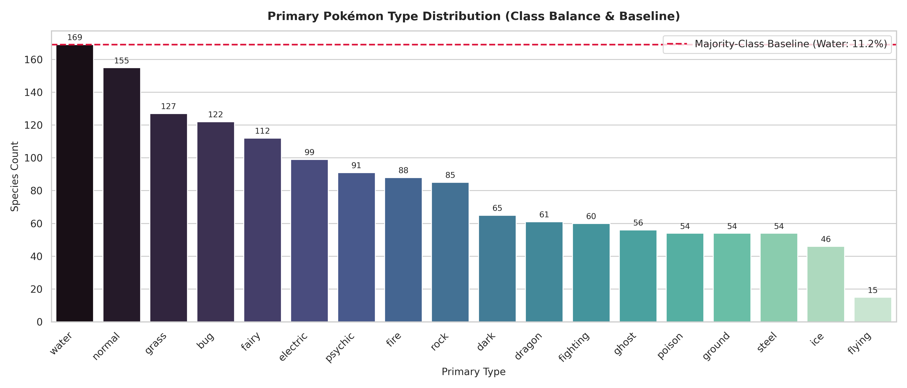
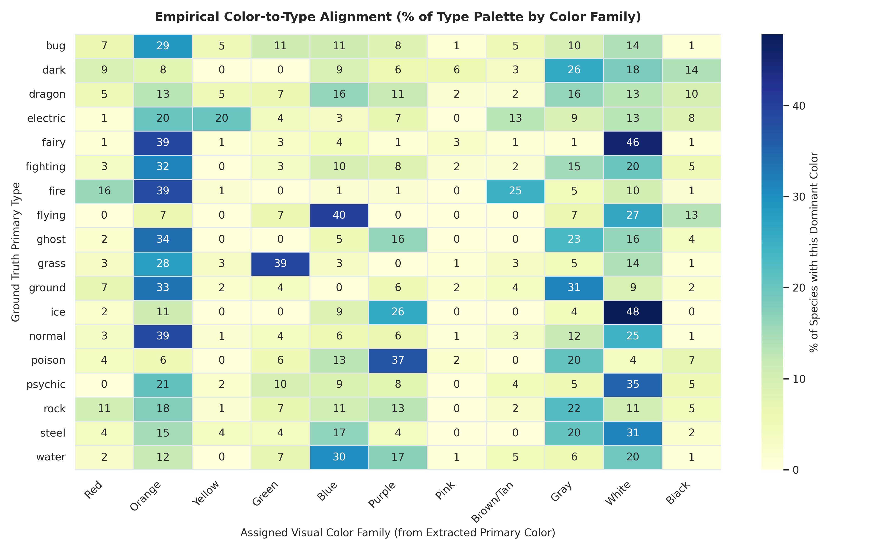

# Data Summary 
The data is divided into two paired CSV files: `pokemon_forms_normal.csv` and `pokemon_forms_shiny.csv`. Both contain 1,514 rows for each unique Pokémon form and match row-for-row; the former file contains the data relevant to normal Pokémon forms (16 columns) and the latter, the shiny Pokémon forms (14 columns). Altogether, these rows cover all 1,025 Pokémon species alongside 492 additional mega, Gigantamax, regional, game-dependent, gender-dependent, and species-variation forms. Every row contains the primary and secondary type, an indication of the form being mega or battle type, the URL to the form’s sprite, and a breakdown of the primary and secondary colors into hex codes and percentages, which are finalized into a single primary hue and color categorization (these variables are not present in the shiny file). The linked sprites are where the image data is stored externally in PokéAPI’s repository [1] to be downloaded and cached locally. These images are 512x512 transparent PNG files. The datasets can be downloaded directly from the GitHub repository at `DS-4002-group-01/project3/DATA/` or be rebuilt by running `SCRIPTS/collection.ipynb`.

# Downloading the Raw Data
The datasets (`pokemon_forms_normal.csv` and `pokemon_forms_shiny.csv`) can be downloaded directly from the GitHub repository at `DS-4002-group-01/project3/DATA/` or rebuilt by running `DS-4002-group-01/project3/SCRIPTS/collection.ipynb`.

# Provenance
The artwork for the different Pokémon forms comes from Pokémon HOME [2], which is a storage app published by the Pokémon Company that renders every species and form in a consistent 3D style. PokéAPI [3] is an all-volunteer open-source project that pulls from these renders to create a sprites repository which the form data links to. Our collection notebook requested the full list of the 1,579 forms from the ‘pokemon-form’ endpoint and recorded the form’s types, flagged mega and battle-only forms, and the HOME render URLs (normal and shiny). The recording excluded any Pokémon without a type or image, and only kept one of Unown’s 28 letter forms since they share type and color, but vary in shape. Additionally, the female render for 10 species whose sexes vary in color were added, and the top two colors for the form are estimated by running K-Means clustering (K=2) on the visible pixels. This data was retrieved on November 10, 2026, by Thieron Cook by running `SCRIPTS/collection.ipynb`. 

# License 
PokéAPI is released under the BSD 3-Clause license [4], which permits use, modification, and redistribution of its data. The license requires that we reproduce the copyright notice and disclaimer in our repository, and prohibits using the PokéAPI name or the names of its contributors to endorse or promote our work without written permission.

# Ethical Statement 
The images used (Pokémon HOME renders) are copyrighted artwork used for non-commercial classroom research. We only link to the images rather than redistribute them, and we attribute them to The Pokémon Company. There is no personal information or human subjects represented in our data. The findings reported describe how certain designers of the Pokémon franchise pair colors with elemental types. These choices should not be interpreted as general rules about color and type associations in different franchises. 

# Data Dictionary
*Disclaimer: Both files share the first 14 columns; primary_hue and color_category exist in the normal file only (`pokemon_forms_normal.csv`). Not all columns were used, so only those used in the model or for exploratory plots are listed below.*

| Feature | Type | Description | Values / Range | Uncertainty |
| :--- | :--- | :--- | :--- | :--- |
| `form_name` | String | PokéAPI assigned form name | 1,514 unique forms (e.g., `vulpix-alola`, `arceus-fire`) | No uncertainty. |
| `gender` | String | The gender for the Pokémon form (default is male) | Default (male; N = 1504) or Female (N = 10) | No uncertainty. |
| `primary_type` | String | The Pokémon’s type listed in slot 1 | 19 unique values, 18 for every different elemental type (e.g., dragon, electric, ice) and 1 “unknown” type | 1 unknown for the `arceus-unknown` form. |
| `secondary_type` | String | The Pokémon’s type listed in slot 2 | 19 unique values, 18 for every different elemental type (e.g., dragon, electric, ice) and 1 blank (indicating no secondary type) | 716 forms have no secondary type associated with them. |
| `is_mega` | Boolean | Binary indicator of whether the form is a mega evolution. | True (N = 97) or False (N = 1417) | No uncertainty. |
| `sprite_url` | String | Link to PNG files in PokéAPI’s HOME render sprite master repository, navigates to either normal or shiny form depending on the dataset. | 1,514 unique links to the HOME render (e.g., `https://raw.githubusercontent.com/…/master/sprites/Pokémon/…/16.png`) | No uncertainty. |
| `primary_color_hex` | String | Hex color code for PokéAPI’s identified dominant color for the form. | 1,469 unique hex color codes (e.g., `#e67a05`) | No uncertainty. |
| `color_category` | String | Rule-based color classification using `primary_color_hex` | 12 unique values (e.g., green, blue, brown/tan, other); Majority color is orange (N = 368) | Minimal uncertainty; Only 3 hex codes could not definitely be placed in one of the 11 color categories and were instead classified as other. |

# Exploratory Plots

***Figure 1.** Forms per primary type, with Water as the majority class (169 forms) and Flying as the smallest class (15 forms).*

***Figure 2.** Percent of each primary type’s different forms whose dominant (primary) color falls into each possible color family (excluding Other). Reveals that certain types align with their expected colors (e.g., grass and green; water and blue; fire and orange), but multiple types are dominated by orange, followed by white.*

# References
[1] PokéAPI Contributors, “PokeAPI/sprites,” GitHub repository, LICENCE.txt (CC0 1.0). [Online]. Available: https://github.com/PokeAPI/sprites. [Accessed: Nov. 9, 2026].
[2] "Category: HOME artwork," Bulbagarden Archives, Jun. 9, 2026. [Online]. Available: https://archives.bulbagarden.net/wiki/Category:HOME_artwork [Accessed: Nov. 11, 2026].
[3] PokéAPI, “PokéAPI: The RESTful Pokémon API.” [Online]. Available: https://pokeapi.co. [Accessed: Nov. 9, 2026].
[4] PokéAPI Contributors, “LICENSE.md,” PokeAPI/pokeapi GitHub repository. [Online]. Available: https://github.com/PokeAPI/pokeapi/blob/master/LICENSE.md. [Accessed: Nov. 9, 2026].
