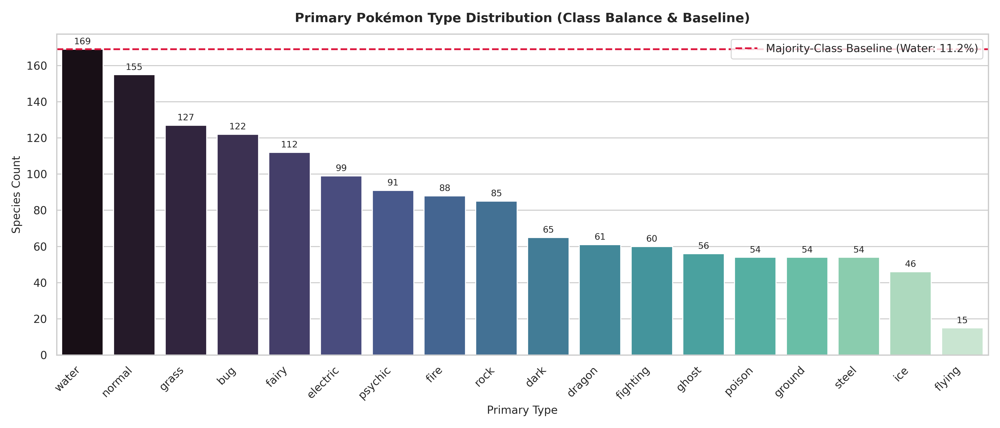
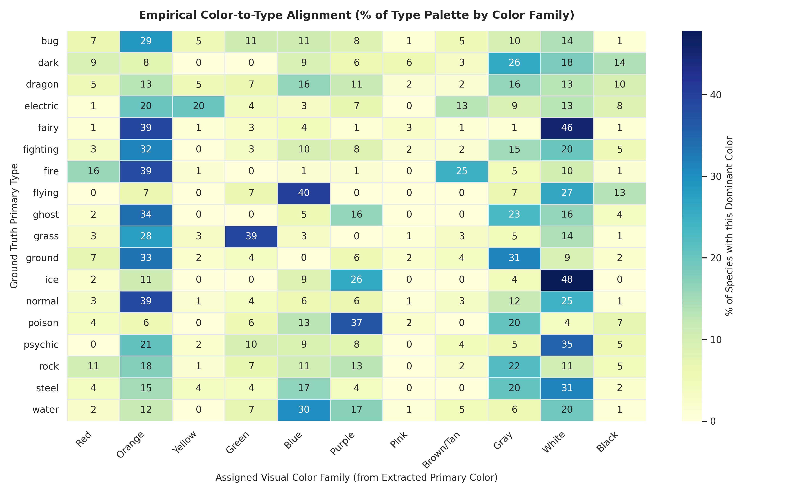

# DATA: Metadata

This folder holds the data for **Fire Is Red, Water Is Blue? Predicting a Pokémon's Type from Its Colors** (DS 4002, Lanturns).

## Files

| File | Description |
| --- | --- |
| `pokemon_forms_normal.csv` | One row per Pokémon form, linking to its normal-colored render (16 columns) |
| `pokemon_forms_shiny.csv` | The same forms in the same row order, linking to the shiny render (14 columns) |
| `sprite_cache/` | Not in the repository. Created when the notebook runs; holds the downloaded sprite images |
| `resnet18_pokemon_type.pth` | Not in the repository. Created when the notebook trains ResNet-18; holds the trained weights |

## Data Summary

The dataset is two paired CSV files, pokemon_forms_normal.csv and pokemon_forms_shiny.csv, with 1,513 rows each: one row per Pokémon form, matched row-for-row between the two files. Together they cover all 1,025 species plus their alternate forms: 97 Mega Evolutions, 34 Gigantamax forms, 60 regional forms (20 Alolan, 20 Galarian, 16 Hisuian, 4 Paldean), 18 Arceus forms, and 18 female-variant rows. Each row carries the form's primary and secondary type (18 types; 798 dual-type and 715 single-type forms), flags for Mega and battle-only forms, a link to its image, and its two dominant colors. The images themselves are not stored in the dataset. Each row links to a 512 × 512 transparent PNG in PokéAPI's sprites repository [1], and the scripts download and cache them locally in DATA/sprite_cache/. Both CSVs live in this folder. They can be downloaded directly or rebuilt by running SCRIPTS/collection.ipynb.

## Provenance

The artwork comes from Pokémon HOME, the storage app published by The Pokémon Company, whose renders show every species and form in one consistent 3D style [2]. PokéAPI [3], an all-volunteer open-source project, serves the type data and links each form to those renders in its sprites repository [1]. Our collection notebook requested the full list of 1,579 forms from the pokemon-form endpoint and recorded each form's types, Mega and battle-only flags, and HOME render URLs (normal and shiny). It skipped forms with no type or no image and kept only one of Unown's 28 letter forms, since they share a type and color. It also added the female render for 10 species whose sexes differ in color. For each image, it estimated the two dominant colors by running k-means clustering (k = 2) on the visible pixels (alpha > 50). The arceus-unknown form, which has no standard type, has since been removed from both files. The data were retrieved on or before November 7, 2026, the date of the commit that added them.

## License

PokéAPI's data are released under the BSD 3-Clause license [4], which permits reuse and redistribution if the copyright notice is kept and the PokéAPI name is not used to endorse our work. The sprites repository is distributed under CC0 1.0 [1], but it states that all images in it remain copyrighted by The Pokémon Company. Our repository therefore stores only image URLs and derived color values, not the images, and our own code is MIT-licensed. The full notices are in LICENSE.md.

## Ethical Statements

The images are copyrighted artwork used for non-commercial classroom research; we link to them rather than redistribute them, and we attribute them to The Pokémon Company. The data contain no personal information and involve no human subjects. Our findings describe how the designers of one franchise pair colors with elements. They should not be read as general rules about color, and our type labels inherit the games' own conventions, such as treating slot 1 as the "primary" type.

## Data Dictionary

Both files share the first 14 columns; primary_hue and color_category exist in the normal file only. Only the columns used in the model or the exploratory plots are listed.

| Feature | Type | Description | Values / Range | Uncertainty |
| --- | --- | --- | --- | --- |
| species_id | Integer | Groups forms for the species-level train/test split | 1 to 1025 | Megas, Gigantamax, and regional forms share their base species' ID (e.g., Mega Charizard X = 6). |
| form_name | String | PokéAPI form name; used to pull out the Arceus test set and label predictions | 1,513 unique (e.g., vulpix-alola, arceus-fire) | Female rows our script added get a -female suffix, and 6 species end up with two female rows. |
| primary_type | String | Type in slot 1; the prediction target | 18 types | Slot order is a game convention. Water is the largest class (169 forms, 11.2%) and Flying the smallest (15). |
| sprite_url | String | Link to the form's render; the model input | HOME render, 512 × 512 RGBA PNG | 16 normal and 23 shiny forms have no HOME render and fall back to a 96 × 96 pixel-art sprite in a different style. |
| is_shiny | Boolean | Whether the row is the shiny render; separates training and shiny test images | False in normal file; True in shiny file | None. |
| primary_color_hex | String | Center of the larger of two k-means color clusters; used in exploration | Hex color, e.g. #e67a05 | An average of two clusters, so it can be a blend no pixel actually has. Sensitive to the alpha cutoff. |
| color_category | String | Rule-based color family of primary_color_hex (normal file only); used for Figure 2 | 11 families + Other (3 rows) | Hand-set RGB thresholds. Tans, creams, and skin tones fall into Orange, the largest family (368 forms). |

## Explanatory Plots

*Figure 1. Forms per primary type, with Water as the majority class (169 forms, 11.2%). Flying is the smallest class with 15 forms, because it appears mostly as a secondary type.*

*Figure 2. Percent of each primary type's forms whose dominant color falls in each color family. Grass, Flying, Poison, Ice, and Fire line up with their expected colors; most other types are dominated by Orange, which captures tan, cream, and skin tones.*

## References

[1] PokéAPI Contributors, "PokeAPI/sprites," GitHub repository, LICENCE.txt (CC0 1.0). [Online]. Available: https://github.com/PokeAPI/sprites. [Accessed: Nov. 9, 2026].

[2] "Category: HOME artwork," Bulbagarden Archives, Jun. 9, 2026. [Online]. Available: https://archives.bulbagarden.net/wiki/Category:HOME_artwork. [Accessed: Nov. 11, 2026].

[3] PokéAPI, "PokéAPI: The RESTful Pokémon API." [Online]. Available: https://pokeapi.co. [Accessed: Nov. 9, 2026].

[4] PokéAPI Contributors, "LICENSE.md," PokeAPI/pokeapi GitHub repository. [Online]. Available: https://github.com/PokeAPI/pokeapi/blob/master/LICENSE.md. [Accessed: Nov. 9, 2026].
