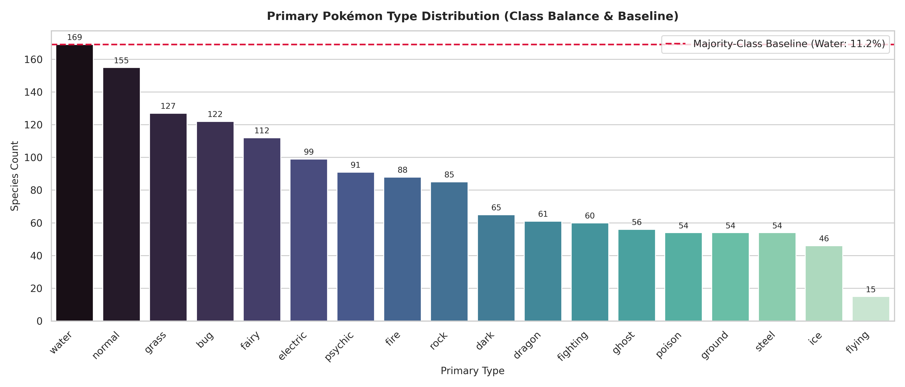
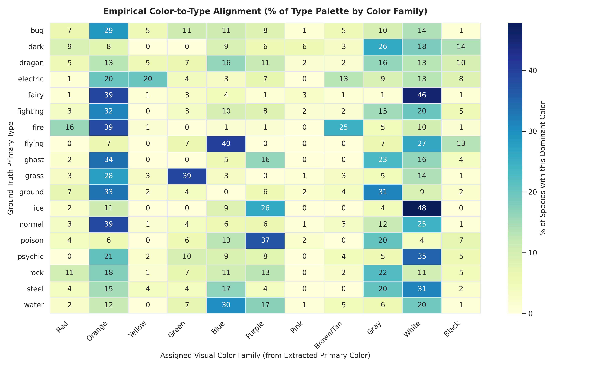
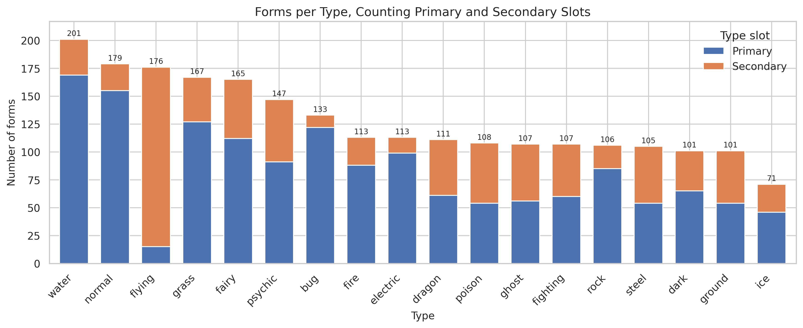
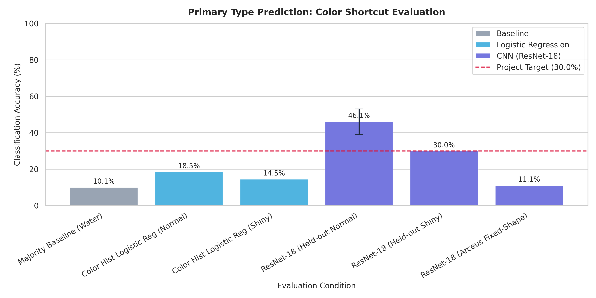

# Output Visualization Explanations
This file explains each figure in `OUTPUT/` and explains its purpose/interpretation.

# Exploratory Data Visualizations

***Figure 1.** Forms per primary type, with Water as the majority class (169 forms) and Flying as the smallest class (15 forms).*

**File:** `plot1_type_distribution.png`

***Figure 2.** Percent of each primary type’s different forms whose dominant (primary) color falls into each possible color family (excluding Other). Reveals that certain types align with their expected colors (e.g., grass and green; water and blue; fire and orange), but multiple types are dominated by orange, followed by white.*

**File:** `plot2_color_type_alignment_heatmap.png`

***Figure 3.** Counts the number of forms containing each of the 18 different primary and secondary types. Reveals that the primary and secondary type with the most forms is Water, the primary type with the most forms is Water, and the secondary type with the most forms is Flying. Alternatively the primary and secondary type with the least forms is Ice, the primary type with the least forms is Flying, and the secondary type with the least forms is Electric.*

**File:** `pokemonTypeCounts.png`

# Results Visualization

***Figure 4.** Displays the classification accuracy across five different models: (1) Majority Baseline (Always classifies Water); (2) Color Histogram Logistic Regression (Classifying Normal Colorings); (3) Color Histogram Logistic Regression (Classifying Shiny Colorings); (4) ResNet-18 (Classifying Normal Colorings); (5) ResNet-18 (Classifying Shiny Colorings). The results show that the ResNet-18 model surpassed the registered target of 30% accuracy in MI1, but there is a replicated drop in accuracy within model types (Color Histogram Logistic Regression vs. ResNet-18) when classifying Shiny colorings (not Normal). This proves that ResNet-18 considers color when predicting the primary type, resulting in confusion when classifying the Shiny variations. Additionally, the large gap in accuracy between the Color Histogram Logistic Regression and ResNet-18 equivalents proves that ResNet-18 is considering other factors like texture and shape when making classifications rather than relying solely on color.*

**File:** `model_comparison_benchmark.png`
